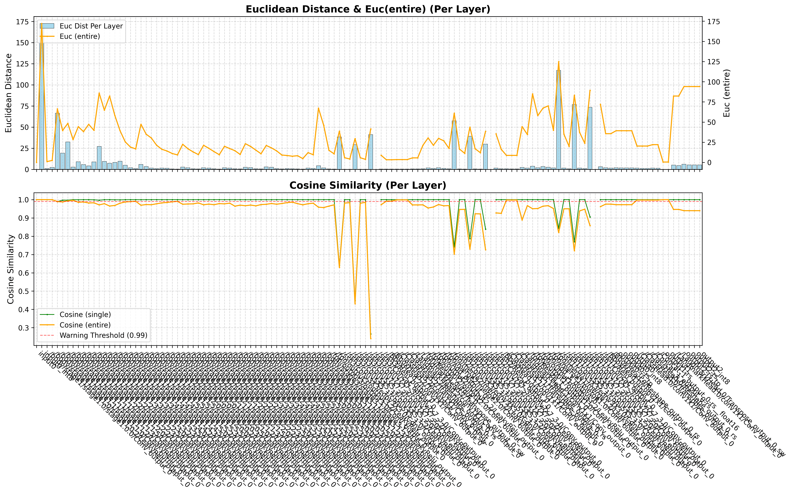
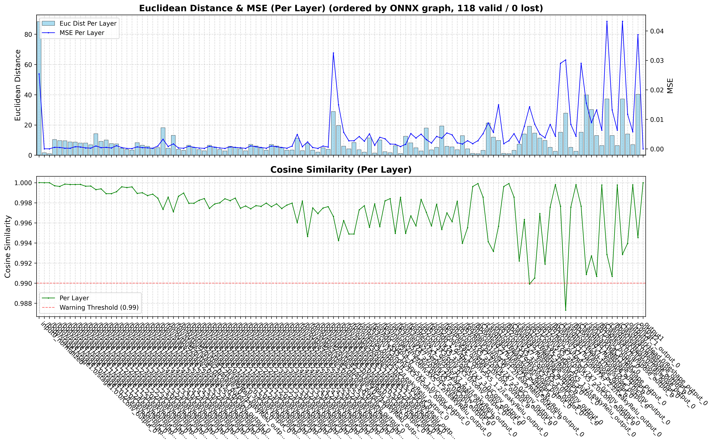
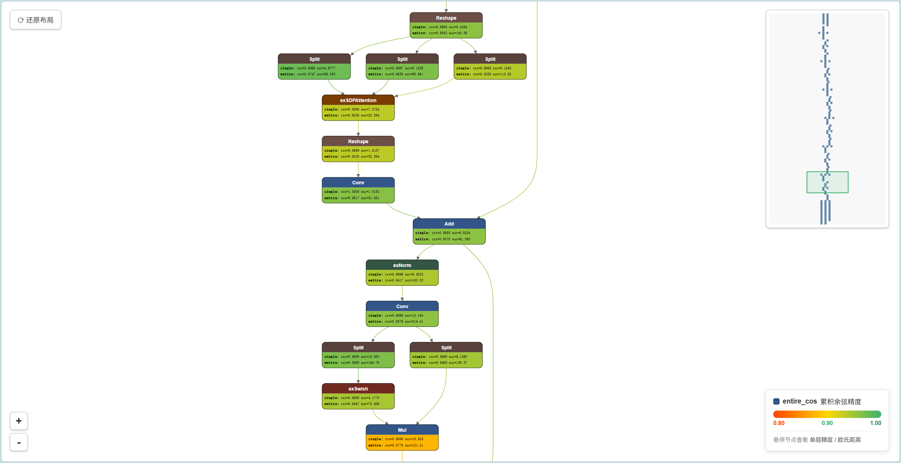
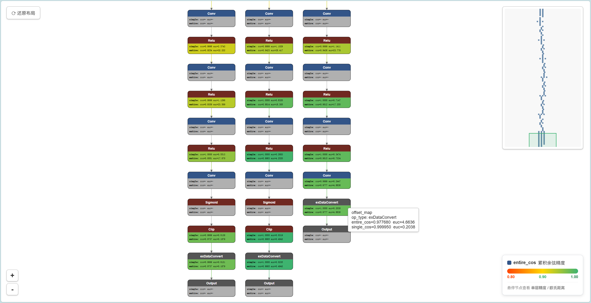

# 📊 量化精度分析指南

## 📖 概述

模型量化（INT8/INT4）虽然能大幅降低模型体积和推理延迟，但不可避免地会引入精度损失。<br>
**精度分析**的作用是：对同一张输入图片，逐层对比 **浮点模型（Golden）** 与 **量化模型（Quantized）** 的中间张量输出，以定位量化损失最大的层，为后续优化（混合量化、调整量化算法、校准数据集优化等）提供数据依据。

本工具链为 **RKNN** 和 **QNN** 两条转换路径均提供了精度分析能力：

| 转换工具 | 精度分析引擎 | 在本工具链的构造 | 触发方式 |
|---------|------------|---------|---------|
| `OnnxToRKNN` | RKNN Toolkit2 内置的 `rknn.accuracy_analysis()` | 直接调用 RKNN Toolkit2 内置的 `rknn.accuracy_analysis()` | 调用转换工具示例的方法 `set_do_accuracy_analysis()` 并传入图片 |
| `OnnxToQNN` | QAIRT `qnn-net-run`：双 DLC 对比（`entire`）+ 逐层截断单算子（`single`） | `QnnAccuracyDebugger`：`entire` 让 Golden DLC（CPU 后端）与量化 DLC 各跑一次 `qnn-net-run --debug` 后逐张量对比；`single` 由 `QnnTruncatedAccuracyAnalysis` 逐层切出单算子子图、单独编译推理后与 Golden 同层比对 | 调用转换工具示例的方法 `set_do_accuracy_analysis()` 并传入图片 |


### 关注的指标

精度分析围绕以下指标评估量化损失：

| 指标 | 含义 | 判断方向 |
|------|------|------|
| **余弦相似度**<br> Cosine Similarity | 衡量两个张量在**方向**上的相似程度，范围 [0, 1]，1 表示完全一致 | 越接近 1 越好，< 0.99 需关注 |
| **欧几里得距离**<br> Euclidean Distance(L2 Distance) | 衡量两个张量在**数值大小**上的绝对差异 | 越小越好，突增处即为问题层 |
| **均方误差**<br> MSE (Mean Squared Error) | 衡量两个张量逐元素差值的平方均值，量级通常很小（千分之一~个位） | 越小越好（QNN 侧绘图时叠加在右轴，辅助判断欧氏距离的真假阳性） |

> 两者结合使用：余弦相似度对方向敏感、不受数值缩放影响；<br>
> 欧氏距离反映绝对量级差异。某层余弦相似度高但欧氏距离大，通常是合理的数值缩放（如量化引入的均匀缩放因子）；<br>
> 两者同时恶化则说明该层量化损失严重。

---

## 🎯 1. RKNN 精度分析

### 1.1 接口调用

在 `OnnxToRKNN` 转换脚本中，调用 `set_do_accuracy_analysis()` 传入用于精度分析的图片路径：

```python
from utilities.onnx_to_rknn import OnnxToRKNN

converter = OnnxToRKNN(
    model_path=MODEL_PATH,
    rknn_model_path=RKNN_MODEL,
    dataset_path=DATASET,
    target_platform='rk3588'
)

# 启用精度分析（传入一张或多张图片）
converter.set_do_accuracy_analysis(
    accuracy_analysis_picture_list=[
        '/path/to/test_image.jpg'
    ]
)

converter.convert(mean_rgb=[[0, 0, 0]], std_rgb=[[255, 255, 255]])
converter.clean()
```

> **注意：** 
> - 单输入模型传入一个图片路径；多输入模型按输入数量传入多个路径。
> - `accuracy_analysis_picture_list` 中的图片**建议不被包含在量化校准数据中**，而是专门用于精度评测，以确保评估的独立性 (包含在也不是不行)。
> - 需在 `convert()` **之前**调用；若未调用或传入 `None`，精度分析将被跳过，不影响正常转换。


### 1.2 分析流程

RKNN 精度分析主要由 RKNN Toolkit2 内置的 `rknn.accuracy_analysis()` 完成：

```
RKNN Toolkit2 内置的 `rknn.accuracy_analysis()` 自动执行
```

然后它生成的**结论**会被绘制成 matplotlib 图表<br>
它生成的**数据**会被 `utilities/accuracy_debugger.py` 里的 `RknnAccuracyDebugger` 进行进一步的解析来绘制整个网络的精度追踪图。

### 1.3 输出文件

分析完成后，结果文件位于 `utilities/tmp/<模型名>_to_rknn/` 下（`OnnxToRKNN` 为每个模型创建的**独立工作子目录**，快照在其 `snapshot/` 子目录中）：

| 目录/文件 | 说明 |
|----------|------|
| `<模型名>_to_rknn/snapshot/golden/` | Golden（浮点）模型逐层中间张量（`.npy` 文件） |
| `<模型名>_to_rknn/snapshot/simulator/` | Simulator（量化）模型逐层中间张量（`.npy` 文件） |
| `<模型名>_to_rknn/snapshot/error_analysis.txt` | 完整逐层精度对比表（全部层数据） |
| `<模型名>_to_rknn/snapshot/map_name_to_file.txt` | 层名与中间张量文件的映射表 |
| `<模型名>_to_rknn/rknn_accuracy_analysis_summary.png` | 可视化汇总图表（由 `render_combined_report()` 生成，见[1.5](#15-可视化图表解读)） |
| `<模型名>_to_rknn/rknn_graph_accuracy_analysis.html` | 可视化计算图精度分析 |

> 📁 以上文件在调用 `clean()` 清理前均可查阅。


### 1.4 终端输出解读
RKNN 精度分析会逐层对比浮点模型（Golden）与量化模型（Simulator）的输出，输出格式如下：

```
I AccuracyAnalysing : 100%|███████████████████████████████████████| 127/127 [00:28<00:00,  4.53it/s]

# simulator_error: calculate the output error of each layer of the simulator (compared to the 'golden' value).
#              entire: output error of each layer between 'golden' and 'simulator', these errors will accumulate layer by layer.
#              single: single-layer output error between 'golden' and 'simulator', can better reflect the single-layer accuracy of the simulator.

layer_name                                                                   simulator_error
                                                                         entire              single
                                                                      cos      euc        cos      euc
------------------------------------------------------------------------------------------------------------
[Input] input0                                                      1.00000 | 0.0       1.00000 | 0.0
[exDataConvert] input0_int8                                         1.00000 | 0.0       1.00000 | 0.0
[Conv] /body/stage1/stage1.0/stage1.0.0/Conv_output_0               1.00000 | 0.4718    1.00000 | 0.4718
[LeakyRelu] /body/stage1/stage1.0/stage1.0.2/LeakyRelu_output_0     1.00000 | 2.4762    1.00000 | 2.4698
[Conv] /body/stage1/stage1.1/stage1.1.0/Conv_output_0               0.99430 | 39.532    0.99432 | 39.498
[LeakyRelu] /body/stage1/stage1.1/stage1.1.2/LeakyRelu_output_0     0.99813 | 16.433    0.99958 | 7.6623
[Conv] /body/stage1/stage1.1/stage1.1.3/Conv_output_0               0.99814 | 22.192    0.99992 | 4.4927
[LeakyRelu] /body/stage1/stage1.1/stage1.1.5/LeakyRelu_output_0     0.99746 | 19.323    0.99996 | 2.7927
...（中间层省略）...
[Conv] /ssh3/conv3X3/conv3X3.0/Conv_output_0                        0.76226 | 34.169    0.77435 | 33.401      <-- ⚠️ entire cos 偏低
[Conv] /ssh3/conv5X5_2/conv5X5_2.0/Conv_output_0                    0.70669 | 26.507    0.71369 | 26.225      <-- ⚠️ single cos 也已偏低
...（中间层省略）...
[Conv] /ssh1/conv3X3/conv3X3.0/Conv_output_0                        0.74489 | 135.43    0.78992 | 124.20
[Conv] /ssh1/conv5X5_2/conv5X5_2.0/Conv_output_0                    0.62190 | 117.09    0.69730 | 106.79      <-- ❌ 严重损失
[Conv] /ssh1/conv7x7_3/conv7x7_3.0/Conv_output_0                    0.64429 | 121.29    0.74632 | 104.17      <-- ❌ 严重损失
...（后续层省略）...
[Conv] /ClassHead.0/conv1x1/Conv_output_0                           0.99765 | 20.991    0.99999 | 1.3997
[exSoftmax13] output1-rs                                            0.99999 | 0.2996    1.00000 | 0.0093
[Conv] /LandmarkHead.0/conv1x1/Conv_output_0                        0.92500 | 101.12    0.99985 | 4.4679
I The error analysis results save to: ./snapshot/error_analysis.txt
```

**指标说明：**（余弦相似度与欧氏距离的基本含义见[概述 · 关注的指标](#关注的指标)）

| 指标 | 含义 | 用途 |
|------|------|------|
| `entire cos` | 累积余弦相似度（从输入到当前层的累计误差） | 反映误差**逐层累积**后的影响，值越低说明前面某层已引入较大偏差 |
| `single cos` | 单层余弦相似度（仅当前层自身的量化误差） | 反映**该层本身**的量化精度，更适合定位具体问题层 |
| `euc` | 欧氏距离 | 辅助指标，与 cos 结合判断量化误差的量级 |


### 1.5 可视化图表解读
#### 1.5.1 统计图表

精度分析完成后会自动读取 `utilities/tmp/<模型名>_to_rknn/snapshot/error_analysis.txt` 并生成可视化汇总图（指标含义参见[概述 · 关注的指标](#关注的指标)），默认保存为 `utilities/tmp/<模型名>_to_rknn/rknn_accuracy_analysis_summary.png`：



`rknn_accuracy_analysis_summary.png` 包含两个子图（布局与 QNN 精度分析保持一致）：

**上图 — 欧氏距离（Euclidean Distance）（逐层柱状图 + 折线图）**
- 天蓝色柱状图：每层的**单层**欧氏距离（`single euc`），柱子突出的层即为单层量化损失最大的层
- 橙色折线（右轴）：每层的**累积**欧氏距离（`entire euc`），反映误差逐层累积后的绝对量级

**下图 — 余弦相似度（Cosine Similarity）（逐层折线图）**
- 橙色折线：每层的**累积**余弦相似度（`entire cos`），反映误差逐层累积的影响
- 绿色折线：每层的**单层**余弦相似度（`single cos`），**低于红线的层需重点关注**
- 红色虚线：0.99 警戒阈值（对于 INT8 量化，0.9 以上通常可接受）

> 💡 结合上图突出的柱与下图跌破红线的层，即可圈定量化损失最大的层，作为混合量化的候选层清单（见[4.2 分析后的优化路径](#42-分析后的优化路径)）。

#### 1.5.2 计算图精度可视化

除统计图表外，精度分析还会自动生成 **Netron 风格的可视化计算图**（`utilities/tmp/<模型名>_to_rknn/rknn_graph_accuracy_analysis.html`），以 DAG 形式呈现整个网络并按累积精度着色，便于观察误差沿数据流的传播路径。详见 [3. 可视化计算图精度分析](#3-可视化计算图精度分析)。

---

## 🎯 2. QNN 精度分析

### 2.1 使用方法

在 `OnnxToQNN` 转换脚本中，调用 `set_do_accuracy_analysis()` 传入用于精度分析的图片路径：

```python
from utilities.onnx_to_qnn import OnnxToQNN

converter = OnnxToQNN(
    model_path=MODEL_PATH,
    qnn_model_path=QNN_MODEL,
    dataset_path=DATASET,
    target_platform='qcs6490'
)

# 启用精度分析（传入一张或多张图片）
converter.set_do_accuracy_analysis(
    accuracy_analysis_picture_list=[
        str(parent_dir / 'datasets/test_image.jpg')
    ]
)

converter.convert(mean_rgb=[[0, 0, 0]], std_rgb=[[1, 1, 1]])
```

> **注意：** 
> - 单输入模型传入一个图片路径；多输入模型按输入数量传入多个路径。
> - `accuracy_analysis_picture_list` 中的图片**建议不被包含在量化校准数据中**，以确保评估的独立性。
> - 需在 `convert()` **之前**调用；若未调用，精度分析将被跳过，不影响正常转换。
> - `convert()` 会自动准备双 DLC 并完成对比：无混合量化时直接用转换产出的**未量化 DLC** 作为 Golden；混合量化时自动再转换一份**纯浮点 Golden DLC**（`<模型名>_golden.dlc`）作参考。

### 2.2 分析流程

QNN 精度分析由 `QnnAccuracyDebugger` 实现，核心是**双 DLC 逐张量对比（`entire` 累计）+ 逐层截断单算子（`single` 单层）**（不再依赖 `snpe-accuracy-debugger` / `qairt-accuracy-debugger`），自动执行以下步骤：

```
┌──────────────────────────────────────────────────────────────┐
│ ① 准备输入：精度分析图片 → 按 ONNX 输入信息 resize/归一化/布局  │
│    转换 → .raw 文件 + input_list.txt                          │
├──────────────────────────────────────────────────────────────┤
│ ② Golden 推理（并行）：qnn-net-run --debug                    │
│    FP32 Golden DLC → CPU 后端（libQnnCpu.so / .dll）          │
│    逐层输出 .raw（文件名 = sanitized 张量名）                  │
├──────────────────────────────────────────────────────────────┤
│ ③ Target 推理（并行）：qnn-net-run --debug                    │
│    量化 DLC → Linux/WoS：HTP 后端（libQnnHtp.so/.dll）        │
│                Windows x86：CPU 后端（无 HTP 执行环境）       │
│    逐层输出 .raw                                              │
├──────────────────────────────────────────────────────────────┤
│ ④ 逐张量对比：按清洗后的张量名精确匹配 → 计算累计(entire)      │
│    Cosine / 欧氏距离 / MSE → 写入精度 CSV                        │
└──────────────────────────────────────────────────────────────┘
```

> **`single`（单层）指标怎么来：** 上图 ②③④ 只产出 `entire`（累计）。`single` 由 `QnnTruncatedAccuracyAnalysis` 逐层单独执行：反射量化 DLC 的层候选 → 每层切出单算子 ONNX 并生成该层的量化编码 → `qairt-converter` 转换 → `qnn-context-binary-generator` 编译 → `qnn-net-run` 推理 → 与 Golden 的同层输出比对（两种布局取最优 Cosine）→ 追加写入同一份精度 CSV。各层并行执行，误差语义与官方 layerwise 一致（其余部分浮点、仅该层量化），因此 `single` 反映的是**该层自身**的量化误差而非累积误差。
>
> 统计图与计算图都从这份精度 CSV 读回渲染，因此 `entire` 与 `single` 会合并在同一张图上；单层分析失败时自动退回仅 `entire` 的报告。

### 2.3 输出文件

> **关于工作目录的说明：** 与 RKNN 一致，QNN 精度分析在**每个模型独立的工作子目录** `utilities/tmp/<模型名>_to_qnn/` 内进行（`qnn-net-run --debug` 直接写出 `.raw` 结果，无 symlink 问题，也不再用 `~/accuracy_analysis/`）。分析产物会登记到调试器的 `file_or_dir_to_clean`，`clean()` 时统一清理。

分析完成后，最终输出文件位于 `utilities/tmp/<模型名>_to_qnn/` 下：

| 目录/文件 | 说明 |
|----------|------|
| `<模型名>_to_qnn/qnn_accuracy_analysis/analysis_inputs/` | 精度分析输入 `.raw`（由图片 / `.npy` / `.raw` 预处理生成） |
| `<模型名>_to_qnn/qnn_accuracy_analysis/input_list.txt` | `qnn-net-run` 输入列表 |
| `<模型名>_to_qnn/qnn_accuracy_analysis/golden_output/` | Golden（FP32）模型逐层输出（`.raw`） |
| `<模型名>_to_qnn/qnn_accuracy_analysis/target_output/` | Quantized 模型逐层输出（`.raw`） |
| `<模型名>_to_qnn/qnn_accuracy_analysis/qnn_accuracy_analysis_layers.csv` | 逐层精度数据（`entire` 与 `single` 两侧指标），统计图与计算图都由此读回渲染 |
| `<模型名>_to_qnn/qnn_accuracy_analysis_summary.png` | 可视化汇总图表（见[2.4](#24-可视化图表解读)） |
| `<模型名>_to_qnn/qnn_graph_accuracy_analysis.html` | 可视化计算图精度分析（见[3](#3-可视化计算图精度分析)） |

> 📁 以上文件在调用 `clean()` 清理前均可查阅。

### 2.4 可视化图表解读

`qnn_accuracy_analysis_summary.png` 由统一的 `plot_accuracy_summary()` 生成，包含两个子图（指标含义参见[概述 · 关注的指标](#关注的指标)）：

**上图 — 欧氏距离（Euclidean Distance）& MSE（单层柱状 + 累计折线）**
- 蓝色折线：每层的**累计**欧氏距离（`entire euc`），折线陡升处即误差累计量级突然增大的区域
- 天蓝色柱状图：每层的**单层**欧氏距离（`single euc`），柱子突出的层即为单层量化损失最大的层
- 青绿色折线（右轴）：每层的 MSE，与欧氏距离结合可判断误差的真假阳性

**下图 — 余弦相似度（Cosine Similarity）（累计 + 单层折线）**
- 蓝色折线：每层的**累计**余弦相似度（`entire cos`），反映误差逐层累积的影响
- 绿色折线：每层的**单层**余弦相似度（`single cos`），**低于红线的层需重点关注**
- 红色虚线：0.99 警戒阈值（对于 INT8 量化，0.9 以上通常可接受）



### 2.5 计算图精度可视化

除统计图表外，精度分析还会自动生成 **Netron 风格的可视化计算图**（`utilities/tmp/<模型名>_to_qnn/qnn_graph_accuracy_analysis.html`），以 DAG 形式呈现整个网络并按**累积精度**着色，便于观察误差沿数据流的传播路径。详见 [3. 可视化计算图精度分析](#3-可视化计算图精度分析)。


## 3. 可视化计算图精度分析

逐层柱状图/折线图（见 [1.5](#15-可视化图表解读)、[2.4](#24-可视化图表解读)）适合定位"哪一层精度差"，但无法直观看出**误差在整张网络中如何沿数据流传播**。为此，工具链额外提供 **Netron 风格的可视化计算图**，把整个网络以"方框节点 + 箭头连线"的 DAG 呈现，并按**累积精度**着色，一眼即可看出精度损失从哪一层开始、向哪些下游扩散。

该能力由 `utilities/accuracy_debugger.py` 中的 `AccuracyGraph` 类实现，**RKNN 与 QNN 两条路径共用同一套渲染逻辑**，仅数据来源不同：

`AccuracyGraph` 负责模型数据适配、指标与名称、节点样式和 HTML 输出，通过组合调用 `NetronGraphLayout` 计算分层、排序、坐标和连接曲线。布局类只接收内部节点标识、邻接关系与尺寸间距。

| 转换路径 | 数据源 | 触发入口 | 输出文件 |
|---------|--------|---------|---------|
| RKNN | `RknnAccuracyDebugger.read_error_analysis()`（解析 `snapshot/error_analysis.txt`，含 `entire` 与 `single`） | `render_combined_report()`（统计图与计算图一并输出） | `rknn_graph_accuracy_analysis.html` |
| QNN | `QnnAccuracyDebugger.load_accuracy_analysis_csv()`（精度 CSV，`entire` + `single`） | `draw_network_analysis(accuracy)`（由 `render_combined_report()` 调用） | `qnn_graph_accuracy_analysis.html` |

> QNN 侧默认以**量化 DLC 为视角**渲染网络图 —— 节点全集、算子类型与连线均由量化 DLC 反射得到，精度中缺失的层照常绘制、指标留空；DLC 信息不可用时回退到 ONNX 视角。


### 3.1 图形解读



- **节点（方框）**：每个分析项一个节点，标签颜色按**算子类型**区分（Netron 色板）。
- **层名与输出张量**：显示当前图中的生产算子名，包含融合后的名称。
- **节点内数值与指标色块**：节点左列为累积余弦精度 `entire_cos`，右列为累积欧氏距离 `entire_euc`，累计数值用大字放在对应色块内。下方白底小字显示对应的 `single` 数值。
- **连线与箭头**：数据流方向，采用 Netron 风格漂浮贝塞尔曲线，跨多层长边会自动插入虚拟节点绕行。
- **层详情**：点击节点或层目录条目，在右侧读取完整层名、单层/累计 cos/euc、可用的累计 MSE 以及上下游层；缺失指标显示“未提供”，不表示分析失败。

> **判读技巧：** 沿数据流找**第一个由绿转红的节点**，即为量化损失的主要来源层；若某节点本身单层精度尚可、但填充色已红，说明误差来自上游，应继续向上追溯。

### 3.2 交互操作

输出为**自包含 SVG + 内联 CSS/JS/数据的单个 HTML**，可单独复制后离线打开。

- **缩放 / 平移**：滚轮缩放、拖拽平移，或 `WASD` 键移动；左下角缩放条上方依次显示键盘与鼠标操作提示，`+` / `-` 按钮缩放。
- **层目录**：默认列出全部实际分析层，可搜索层名、输出张量名、算子类型并排序。左上与右上按钮分别收展目录和详情。
- **还原视图**：左下缩放条中的还原按钮回到初始视图。
- **小地图**：右下竖向缩略图实时显示当前视口；点击定位，按住拖动时主画布和视窗框连续同步。
- **图例**：右侧详情中的“图例”分别标注累计 cos/euc 颜色范围；cos 刻度为 ≤0.80、0.90、1.00，euc 显示本报告范围，黄色位于范围的 25%，红区从 50% 起。该范围不作为跨模型统一标尺。
- **复制与触控**：完整层名可复制；选中文本，可按 `Ctrl+C`。画布可双指缩放，侧栏可滚动；输入搜索词时不会触发 `WASD` 平移。


### 3.3 典型分析场景

**1. 区分多输出网络各输出的精度。** 对于检测/分割/多任务等**多输出网络**，逐层图表只能给出一个整体序列，难以分辨"到底是哪一路输出精度差"。可视化计算图把每个 **Output 终端节点**独立呈现并各自着色，可**直接对比各输出分支的累积精度**——哪一路输出节点偏红，就说明该任务/分支的量化损失更大，从而针对性地对该分支做混合量化或校准优化，而非笼统地处理整网。



**2. 分析量化器对上游误差的"修复"。** 量化器（Quantize/Dequantize 节点）不仅会引入误差，其**取整/缩放行为有时也能"吸收"上游累积的微小误差**，使下游某层的累积精度反而回升。在计算图中，这种"先变红、下游又转绿"的**精度回升**会直观地体现在节点填充色上：若某量化器下游节点由红转绿，说明该量化器对上游误差起到了修复/抑制作用。这一现象在纯数值表格中不易察觉，而在着色计算图中一目了然，有助于判断哪些量化器是"误差源"、哪些是"误差缓冲"，为混合量化时保留/裁剪子图提供依据。

---

## 💡 4. 精度分析最佳实践

### 4.1 图片选择

- 选择**模型实际应用场景中具有代表性**的图片
- **一次精度分析只使用一组图片**（每个输入节点对应一张图片，单输入模型传 1 张，多输入模型按输入数量传多张）
- 精度分析图片应**不**包含在量化校准数据集中，保证评估的客观性

### 4.2 分析后的优化路径

| 发现的问题 | 建议的优化方案 |
|-----------|--------------|
| 整体余弦相似度（Cosine Similarity）偏低（< 0.95） | ① 更换量化算法（如 `entropy` → `kl_divergence`）<br>② 扩充/替换量化校准数据集 |
| 仅个别层余弦相似度（Cosine Similarity）偏低 | 对该层/子图做**混合量化**（QNN：16-bit 整数子图或 FP16/FP32 浮点子图，RKNN：FP16 子图，详见 [TOOLUSE.md → 3.4 混合量化](./TOOLUSE.md#34-混合量化)） |
| 某些层欧氏距离（Euclidean Distance）特别大 | 检查该层是否为激活函数层（如 Sigmoid/Softmax），<br>此类层对量化敏感，建议混合量化 |
| QNN 中实际匹配到的层数远少于预期 | 部分张量在 Golden 与 Quant 输出间无法精确匹配（命名差异 / 图优化被融合消除），<br>通常可忽略；若过少需检查模型转换是否异常 |

---


## ⚠️ 5. 注意事项

1. **RKNN 相关工具（含精度分析）仅支持 Linux 环境**；QNN 转换与精度分析在 **Windows 与 Linux 均可运行**（Windows x86 无 HTP 执行后端，量化模型的精度分析自动退化为 CPU 后端，HTP 后端端到端精度建议在 Linux / 目标设备上验证）。
2. **如果未设置 `accuracy_analysis_picture_list` 或设为 `None`** — 精度分析将被跳过，不影响正常转换流程。
3. **精度分析会显著增加转换时间** — `entire` 需要对同一输入在未量化和量化模型上分别做一次完整推理，耗时约为正常转换的 2~3 倍。
4. **精度分析结果保存在 `utilities/tmp/<模型名>_to_rknn/` 与 `utilities/tmp/<模型名>_to_qnn/` 工作子目录** — 建议每次分析后保存图表以便对比不同量化配置的效果。
5. **所有精度分析结果在调用 `clean()` 前均可查阅** — `clean()` 会清空对应工作子目录下的临时文件，如需保留分析结果请在调用前手动备份。
